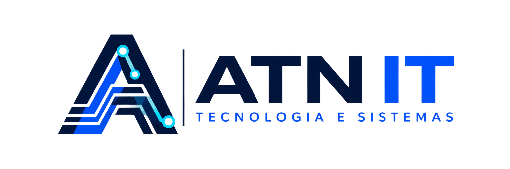
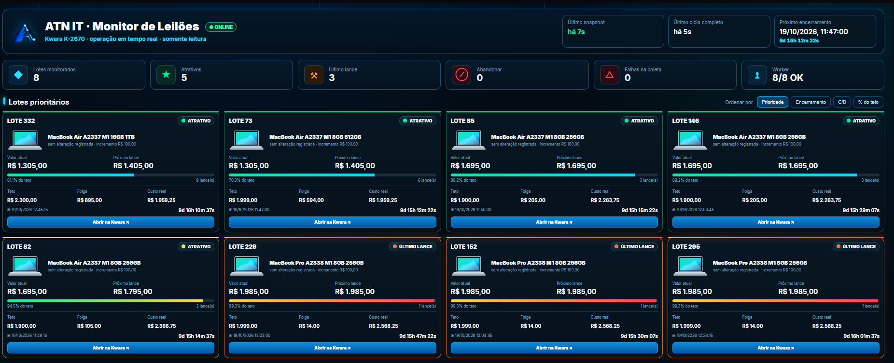
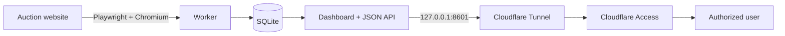

# ATN IT · Kwara Monitor

**English** · [Português (Brasil)](README.pt-BR.md)



Personal, read-only auction monitoring dashboard built to centralize lot status, bidding cost calculations, bidding ceilings, historical changes and time-to-close information.

> **Independent personal project.** This repository is not affiliated with or endorsed by the auction platform whose public pages are monitored.

## Current release

**v0.4.3 — Smooth Live Update**

The production dashboard is a lightweight Python HTTP application. It loads the UI once and refreshes state through `/api/state`, avoiding full-page refreshes while countdowns continue updating in the browser.



## What it does

- monitors configured lots in read-only mode;
- captures current value, next bid, bid count, increment and closing time;
- calculates real cost using auction fees and commission;
- compares the next bid with a configured ceiling;
- classifies lots as **ATRATIVO**, **ÚLTIMO LANCE** or **ABANDONAR**;
- stores historical snapshots in SQLite;
- presents priority cards, consolidated table, lot detail and history;
- exposes `/health` and `/api/state` endpoints;
- runs worker and dashboard as systemd services;
- supports private publication through Cloudflare Tunnel + Access.

## Architecture



More detail: [docs/ARCHITECTURE.md](docs/ARCHITECTURE.md)

## Stack

- Python 3.12+
- Playwright + Chromium
- SQLite
- HTML / CSS / JavaScript
- Linux / systemd
- Oracle Cloud Infrastructure (ARM64 in the production deployment)
- Cloudflare Tunnel + Access

> **Note:** Streamlit was used in earlier dashboard iterations. Starting with v0.4.3, the production dashboard uses Python's `ThreadingHTTPServer` plus a JSON API and browser-side JavaScript.

## Repository structure

```text
app/
  dashboard.py      # V0.4.3 HTTP dashboard + /api/state + /health
  worker.py         # persistent Playwright worker
  scraper.py        # auction page parser
  pricing.py        # fee and cost calculations
  db.py             # SQLite schema/persistence
config/
  lots.example.json # safe example; lots.json is intentionally ignored
systemd/
  kwara-worker.service
  kwara-dashboard.service
scripts/
  install.sh
  healthcheck.sh
docs/
  ARCHITECTURE.md
  OPERATIONS.md
  PORTFOLIO.md
  screenshots/
tests/
.github/workflows/
```

## Quick start

```bash
git clone <YOUR_REPOSITORY_URL>
cd kwara-monitor
chmod +x scripts/install.sh
./scripts/install.sh
```

Then edit the runtime configuration before starting the worker:

```bash
nano /opt/kwara-monitor/config/lots.json
```

Start the services:

```bash
sudo systemctl start kwara-worker.service
sudo systemctl start kwara-dashboard.service
```

Health check:

```bash
curl -fsS http://127.0.0.1:8601/health
```

Expected response:

```json
{"ok": true, "version": "0.4.3"}
```

## Security model

The production design intentionally binds the dashboard only to:

```text
127.0.0.1:8601
```

Do **not** expose port 8601 directly to the Internet. The intended remote-access pattern is Cloudflare Tunnel with Cloudflare Access / Zero Trust in front of the application.

Runtime databases, private bidding configuration, tokens, SSH keys and credentials are excluded from version control. See [SECURITY.md](SECURITY.md).

## Tests

```bash
python -m unittest discover -s tests -v
```

CI also compiles the application and runs the unit tests on pushes and pull requests.

## Operational validation

The production deployment has been validated through a controlled VM reboot, confirming automatic startup of the monitoring worker, dashboard and Cloudflare connector.

## Version history

See [CHANGELOG.md](CHANGELOG.md).

## Documentation

- [Architecture](docs/ARCHITECTURE.md)
- [Operations](docs/OPERATIONS.md)
- [Portfolio notes](docs/PORTFOLIO.md)
- [Security](SECURITY.md)

## License / usage

This repository represents a personal ATN IT project. No open-source license is granted unless a license file is added explicitly in the future.
