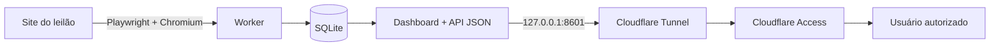

# ATN IT · Kwara Monitor

[English](README.md) · **Português (Brasil)**


Dashboard pessoal e somente leitura para monitoramento de leilões, desenvolvido para centralizar o status dos lotes, cálculos de custo, tetos de lance, histórico de alterações e tempo restante até o encerramento.

> **Projeto pessoal independente.** Este repositório não possui vínculo, afiliação ou endosso da plataforma de leilões cujas páginas públicas são monitoradas.

## Versão atual

**v0.4.3 — Smooth Live Update**

O dashboard de produção é uma aplicação HTTP leve em Python. A interface é carregada uma única vez e o estado é atualizado através do endpoint `/api/state`, evitando recarregamentos completos da página enquanto os contadores regressivos continuam sendo atualizados no navegador.


## O que o sistema faz

- monitora lotes configurados em modo somente leitura;
- coleta valor atual, próximo lance, quantidade de lances, incremento e horário de encerramento;
- calcula o custo real considerando taxas administrativas e comissão do leilão;
- compara o próximo lance com o teto configurado para cada lote;
- classifica os lotes como **ATRATIVO**, **ÚLTIMO LANCE** ou **ABANDONAR**;
- armazena snapshots históricos em SQLite;
- exibe cards de prioridade, tabela consolidada, detalhe do lote e histórico de alterações;
- disponibiliza os endpoints `/health` e `/api/state`;
- executa worker e dashboard como serviços `systemd`;
- permite publicação privada através de Cloudflare Tunnel + Access.

## Arquitetura



Mais detalhes: [docs/ARCHITECTURE.md](docs/ARCHITECTURE.md)

## Stack

- Python 3.12+
- Playwright + Chromium
- SQLite
- HTML / CSS / JavaScript
- Linux / systemd
- Oracle Cloud Infrastructure — OCI (ARM64 no ambiente de produção)
- Cloudflare Tunnel + Access

> **Observação:** o Streamlit foi utilizado em versões anteriores do dashboard. A partir da v0.4.3, a versão de produção utiliza `ThreadingHTTPServer` do Python, API JSON e JavaScript no navegador.

## Estrutura do repositório

```text
app/
  dashboard.py      # Dashboard HTTP V0.4.3 + /api/state + /health
  worker.py         # Worker Playwright persistente
  scraper.py        # Parser das páginas do leilão
  pricing.py        # Cálculos de taxas e custo real
  db.py             # Schema e persistência SQLite
config/
  lots.example.json # Exemplo seguro; lots.json é ignorado intencionalmente
systemd/
  kwara-worker.service
  kwara-dashboard.service
scripts/
  install.sh
  healthcheck.sh
docs/
  ARCHITECTURE.md
  OPERATIONS.md
  PORTFOLIO.md
  screenshots/
tests/
.github/workflows/
```

## Instalação rápida

```bash
git clone <URL_DO_SEU_REPOSITORIO>
cd kwara-monitor
chmod +x scripts/install.sh
./scripts/install.sh
```

Depois, edite a configuração utilizada em runtime antes de iniciar o worker:

```bash
nano /opt/kwara-monitor/config/lots.json
```

Inicie os serviços:

```bash
sudo systemctl start kwara-worker.service
sudo systemctl start kwara-dashboard.service
```

Verifique a saúde da aplicação:

```bash
curl -fsS http://127.0.0.1:8601/health
```

Resposta esperada:

```json
{"ok": true, "version": "0.4.3"}
```

## Modelo de segurança

O ambiente de produção foi projetado para manter o dashboard escutando somente em:

```text
127.0.0.1:8601
```

**Não exponha a porta 8601 diretamente à Internet.** O modelo previsto para acesso remoto utiliza Cloudflare Tunnel com Cloudflare Access / Zero Trust na frente da aplicação.

Bancos de dados de runtime, configurações privadas de lance, tokens, chaves SSH e credenciais são excluídos do versionamento. Consulte [SECURITY.md](SECURITY.md).

## Testes

```bash
python -m unittest discover -s tests -v
```

O CI também compila a aplicação e executa os testes unitários em pushes e pull requests.

## Validação operacional

O ambiente de produção foi validado através de um reboot controlado da VM, confirmando a inicialização automática do worker de monitoramento, dashboard e conector Cloudflare.

## Histórico de versões

Consulte [CHANGELOG.md](CHANGELOG.md).

## Documentação

- [Arquitetura](docs/ARCHITECTURE.md)
- [Operação](docs/OPERATIONS.md)
- [Notas de portfólio](docs/PORTFOLIO.md)
- [Segurança](SECURITY.md)

## Licença / uso

Este repositório representa um projeto pessoal da ATN IT. Nenhuma licença open source é concedida enquanto um arquivo de licença não for adicionado explicitamente no futuro.
