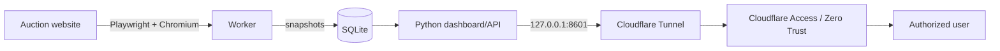

# Architecture

## Worker

The worker keeps one Chromium browser alive and processes enabled lots sequentially. Polling becomes more frequent as the nearest lot approaches its closing time:

- more than 24 h: 5 minutes
- 24 h to 2 h: 2 minutes
- 2 h to 15 min: 60 seconds
- less than 15 min: 30 seconds

## Persistence

SQLite stores snapshots and worker health state. WAL mode is enabled for lightweight concurrent reads while the worker writes new snapshots.

## Dashboard

Version 0.4.3 uses the Python standard library `ThreadingHTTPServer` rather than Streamlit. The page is loaded once, `/api/state` is polled in the background, and JavaScript updates values without a full reload.

## Production ingress

The dashboard should remain private on loopback (`127.0.0.1:8601`). A Cloudflare Tunnel can publish the service without an inbound firewall rule for port 8601, while Cloudflare Access can restrict access to authorized identities.
